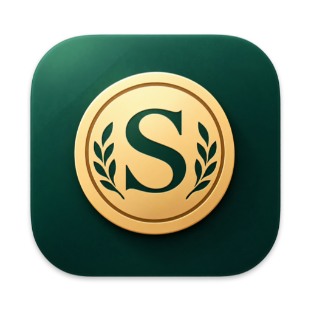
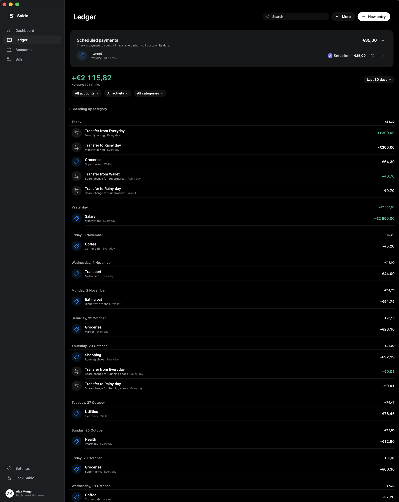

<div align="center">



# Saldo

**Know where your money goes.**

A private, native macOS app for tracking accounts, spending, debts and monthly bills.


[](LICENSE)
<!-- TODO: add version and build status badges once releases and CI exist -->

</div>

## Table of contents

- [About](#about)
- [Screenshots](#screenshots)
- [Features](#features)
- [Getting started](#getting-started)
  - [Prerequisites](#prerequisites)
  - [Installation](#installation)
  - [Configuration](#configuration)
- [Usage](#usage)
- [Tech stack](#tech-stack)
- [Project structure](#project-structure)
- [Running tests](#running-tests)
- [Troubleshooting](#troubleshooting)
- [Contributing](#contributing)
- [License](#license)
- [Acknowledgements and contact](#acknowledgements-and-contact)

## About

Saldo is a personal finance ledger for one person on one Mac. You record income,
expenses and transfers across your accounts, and Saldo shows your net worth, your
available cash and how much you have left this month once your bills are paid.

Everything stays on your Mac. The database is encrypted, it only opens after Touch ID or
your Mac password, and nothing is sent to a server.

## Screenshots

<!-- TODO: add screenshots to docs/images/ and list them here. Example layout:

<table>
  <tr>
    <td align="center">
      <br>
      <sub>Dashboard</sub>
    </td>
    <td align="center">
      <br>
      <sub>Ledger</sub>
    </td>
  </tr>
</table>

Debug builds can capture every section on sample data; see "Configuration" below.
-->

## Features

- 🏦 **Accounts:** cash, checking, savings and investment accounts, each in its own currency, with hand-entered exchange rates.
- 🧾 **Ledger:** income, expenses and transfers grouped by day, with search (⌘F), filters by date, account, type and category, and undo (⌘Z) for deletions.
- 🗓️ **Scheduled payments and refunds:** set money aside now for something that posts on a later date.
- 🪙 **Spare change:** round an expense up to the next whole unit and move the difference into a savings account.
- 📈 **Update value:** match an account to its real balance; Saldo records the gain or loss.
- 🤝 **Debts:** track money you owe or are owed, and record payments from your accounts.
- ✅ **Monthly bills:** a checklist of what repeats each month that shows what is left, without creating ledger entries.
- 📊 **Dashboard:** net worth with its change over time, balance history, six months of cash flow, spending by category and recent activity.
- 🔒 **Privacy:** an AES-GCM encrypted database, Touch ID or Mac password unlock, and auto-lock after inactivity.
- 💾 **Backups:** a daily encrypted backup kept for 30 days, manual backup and restore, and CSV export.
- 🧮 **Calculator amounts:** type `12.50 + 3` or `100 - 10%` into any amount field.

## Getting started

### Prerequisites

- macOS 14 Sonoma or later
- Xcode 16 or a Swift 6 toolchain (the package uses `swift-tools-version: 6.0`)
- A Mac with Touch ID or a login password (Saldo uses it to unlock)

### Installation

1. Clone the repository.

   ```bash
   git clone https://github.com/tfcmarques/saldo.git
   cd saldo
   ```

2. Build and install the app. This builds a release version, signs it for local use and
   copies it to `/Applications/Saldo.app`. If Saldo is open, the script quits it first.

   ```bash
   scripts/build-app.sh
   ```

3. Open Saldo from `/Applications` and register with Touch ID or your Mac password.

### Configuration

Saldo needs no configuration to run. Two environment variables exist for development and
only work in **debug** builds; release builds ignore them.

| Name | Description | Required | Default |
|---|---|---|---|
| `SALDO_TEST_DATA_DIR` | Keeps all data and preferences in this folder instead of your real Saldo data, skips Touch ID, and fills an empty ledger with sample data. | No | Not set (uses your real data) |
| `SALDO_SNAPSHOT_DIR` | With `SALDO_TEST_DATA_DIR`, saves a picture of every section in light and dark mode to this folder, then quits. | No | Not set |

> [!WARNING]
> A debug build run **without** `SALDO_TEST_DATA_DIR` opens your real data. Use the
> variable whenever you run Saldo from source.

## Usage

1. **Add your accounts.** Go to Accounts and click **Add account**. Give it a name, type,
   currency and opening balance. Turn off **Count in net worth** for money set aside, such
   as tax savings.
2. **Record what happens.** Click **New entry** (⌘N) to add income or an expense, or use
   **Transfer** (⇧⌘N) to move money between accounts. A future date turns the entry into a
   scheduled payment.
3. **Keep balances true.** When an account's real balance differs, use **Update value** and
   enter what the account holds now.
4. **Track debts.** On Accounts, click **Add debt**. Click a debt to see what is left and to
   record payments.
5. **Plan the month.** On Bills, list what you pay every month. Tick each bill once it is
   paid or skipped to see what is left. Ticks clear on the 1st.
6. **Back up.** In Settings (⌘,) you can export a CSV, save an encrypted backup or restore
   one. A backup only opens in Saldo on the same Mac.

Lock Saldo at any time with ⌘L.

To try Saldo from source on sample data, without touching your own:

```bash
swift build
SALDO_TEST_DATA_DIR=/tmp/saldo-test .build/debug/Saldo
```

## Tech stack

- **Swift 6** and **SwiftUI**, as a Swift Package with no third-party dependencies
- **SQLite**, kept in memory while unlocked and saved as an encrypted snapshot
- **CryptoKit** (AES-GCM) for encryption
- **LocalAuthentication** for Touch ID and Mac password unlock
- **Swift Charts** for the dashboard

## Project structure

```text
saldo/
├── Package.swift            Swift package definition
├── Sources/Saldo/           The app
│   ├── SaldoApp.swift       App entry, window and menu commands
│   ├── DesignSystem.swift   Colours, type, spacing and shared components
│   ├── LedgerStore*.swift   Data, encryption, backups and calculations
│   ├── *View.swift          One file per section (Dashboard, Ledger, Bills, ...)
│   └── Resources/           In-app icon
├── docs/DESIGN.md           The design system: tokens, components and rules
├── scripts/
│   ├── build-app.sh         Builds, signs and installs Saldo.app
│   ├── draw-icon.swift      Draws the app icon
│   └── make-icon.swift      Turns the icon into an icon set
└── Tests/                   Reserved for tests (empty for now)
```

## Running tests

There are no automated tests yet. `Tests/LedgerTests` exists but the package does not
declare a test target.

<!-- TODO: add a test target to Package.swift and document `swift test` here -->

To check that everything compiles:

```bash
swift build
```

## Troubleshooting

**"This Mac can't verify your identity."**
Saldo needs Touch ID or a login password. Set one up in System Settings, then open Saldo
again.

**"The database key is missing" or "Could not decrypt this database."**
The key file next to the database is missing or does not match. Saldo leaves your saved
file in place and tries the newest daily backup that still opens. Restore a backup from
Settings if you have one.

**The Dock or Finder still shows the old icon after an update.**
macOS caches app icons. Restart the Dock and Finder:

```bash
killall Dock
touch /Applications/Saldo.app && killall Finder
```

**Totals look wrong for an account in another currency.**
Set its exchange rate in Settings. The dashboard warns when a rate is missing.

## Contributing

1. Fork the repository.
2. Create a branch for your change.

   ```bash
   git checkout -b my-change
   ```

3. Make your change. For UI work, follow [docs/DESIGN.md](docs/DESIGN.md).
4. Check that it builds and try it on sample data.

   ```bash
   swift build
   SALDO_TEST_DATA_DIR=/tmp/saldo-test .build/debug/Saldo
   ```

5. Commit and push, then open a pull request that describes what changed and why.

<!-- TODO: link CONTRIBUTING.md here if one is added -->

## License

Saldo is free software, released under the
[GNU General Public License v3.0](LICENSE). You can use, study, share and change it. If you
distribute Saldo or a modified version, you must make its source code available under the
same licence.

Copyright (C) 2026 tfcmarques

## Acknowledgements and contact

Made by tfcmarques.

<!-- TODO: add contact or social links -->
